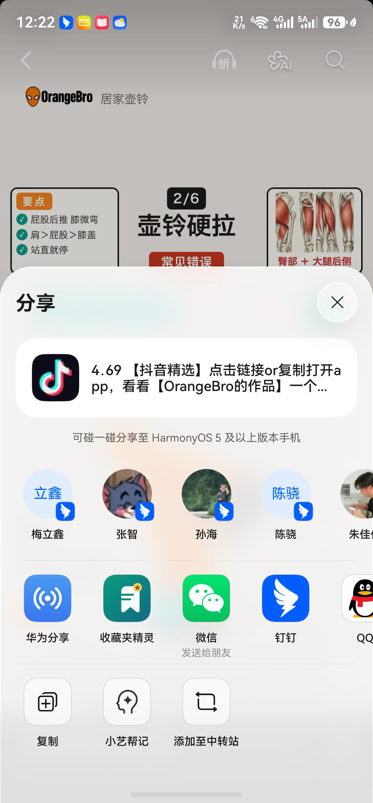
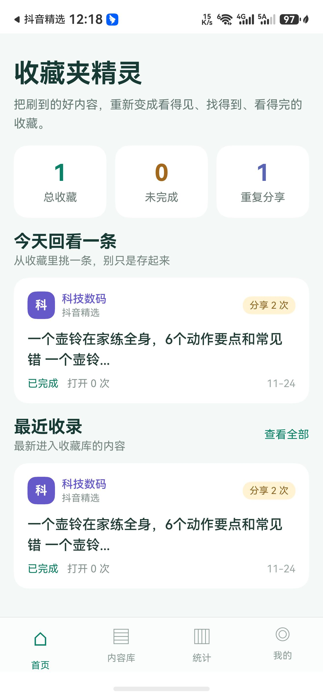
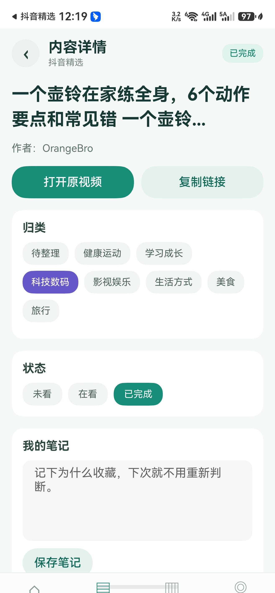
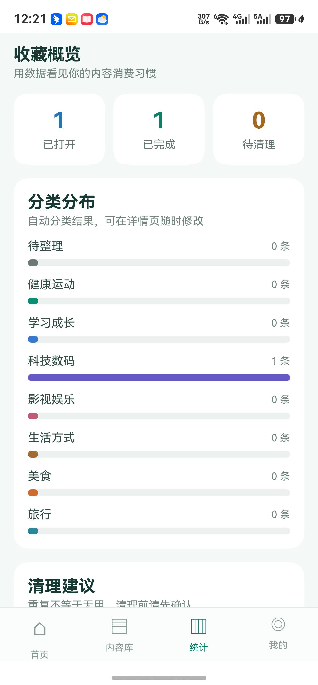

# 收藏夹精灵

面向 HarmonyOS 的本地收藏内容管理 MVP。通过系统分享把抖音精选、哔哩哔哩、小红书、快手、微博、知乎等内容链接收进统一内容库，并完成自动分类、重复分享合并、搜索、状态管理和使用统计。


当前版本：`0.3.2`
验证状态：已在 HarmonyOS 7 真机完成核心链路测试

## 已实现功能

- 抖音精选、哔哩哔哩、小红书、快手、微博、知乎、视频平台和常用内容网站的“系统分享”入口
- 根据分享链接域名识别已知平台；未知 HTTPS 域名保留实际域名，不再统一归为“其他来源”
- 启动时自动修正历史错误来源
- 分享后自动保存标题、链接、来源平台或域名和收藏时间
- 基于规则的内容自动分类
- 同一内容重复分享时合并为一条记录并累计分享次数
- 分类筛选、标题/作者/标签/笔记搜索
- 内容详情、打开原视频、复制链接
- 手动修改分类、状态和笔记
- 首页指标、最近收录、今日回看
- 分类分布、打开数、完成数和待清理统计
- 本地关系型数据库持久化
- 数据库 schema 版本与增量迁移机制
- 应用市场更新检测，以及自定义 HTTPS 更新清单、HAP 下载和 SHA-256 校验
- 默认不联网、不登录抖音、不读取抖音私有收藏

## 真机验证结果

已在华为 `PLA-AL10`、HarmonyOS `7.0.0.111`、API 26、抖音精选 `41.3.0` 上验证：

- 分享面板中可找到“收藏夹精灵”
- 可从“系统分享”成功传回抖音分享链接
- 首次分享自动收录并分类
- 重复分享同一链接不会产生重复记录
- 分享次数能够累计
- 分类、完成状态可即时修改
- 统计页与详情页可以正常使用

详细记录见 [TEST_RESULT.md](TEST_RESULT.md)。

## 关键截图









## 技术方案

- ArkTS / ArkUI
- HarmonyOS API 26
- `@kit.ShareKit` 接收系统分享
- `@kit.ArkData` 关系型数据库持久化
- `@kit.BasicServicesKit` 剪贴板
- 本地规则分类与规范化链接去重

核心文件：

- `entry/src/main/ets/entryability/EntryAbility.ets`：接收和分析系统分享数据。
- `entry/src/main/ets/data/CollectionRepository.ets`：收藏数据模型、分类、去重和数据库操作。
- `entry/src/main/ets/pages/Index.ets`：首页、内容库、统计、详情和设置界面。
- `entry/src/main/module.json5`：注册系统分享目标。

## 安装包

可直接安装的调试签名包：

[artifacts/collection-genie-0.3.2.hap](artifacts/collection-genie-0.3.2.hap)

SHA-256：

```text
cf05538285a64679bb12560aebcbe7c285e3a5fa96be285231d538962901ac76
```

该 Profile 只绑定当前测试手机的 UDID，重新签名前不能保证安装到其他手机。

## 使用方式

1. 打开抖音精选视频详情页。
2. 点击右下角“分享”。
3. 在抖音分享面板的底部横向滑动，选择“系统分享”。
4. 在系统分享面板中向左滑动，选择“收藏夹精灵”。
5. 回到收藏夹精灵后，内容会进入内容库并自动分类。

哔哩哔哩、小红书、快手、微博、知乎等应用同样通过“分享 → 系统分享 → 收藏夹精灵”收录。

## 版本升级

“我的”页面可以：

1. 优先调用 AppGallery Kit 检查应用市场更新。
2. 从可配置的 HTTPS 清单地址读取 `versionName`、`versionCode`、`downloadUrl`、`sha256` 和 `releaseNotes`。
3. 下载 HAP 并校验 SHA-256。
4. 校验通过后打开系统安装/文件打开界面，由用户确认安装。

仓库内的 [update-manifest.json](update-manifest.json) 是清单模板和字段示例。仓库已经公开，默认通过 jsDelivr 的 `latest` 标签读取清单，发布新版本标签即可自动更新；也可以在“我的”页面替换为其他可匿名访问的 HTTPS 地址。

HarmonyOS 对普通侧载应用不允许静默安装。正式上架后应优先使用 AppGallery Kit 的官方更新弹窗；未上架版本完成下载和 SHA-256 校验后，只能打开系统提供的安装或文件打开界面，再由用户确认。

## 开发与构建

建议使用 DevEco Studio 6.0 或更高版本，并安装 HarmonyOS API 26 SDK。

1. 用 DevEco Studio 打开项目根目录。
2. 在 `Project Structure > Signing Configs` 中配置自动调试签名。
3. 连接真机并运行 `entry` 模块。

注意：当前工程实际目录包含中文字符。本项目验证时发现 Hvigor 命令行不接受中文项目路径，因此命令行构建使用了 ASCII 临时目录。后续持续开发建议将工程放到例如 `D:\collection-genie` 的纯英文路径。

## 当前限制

- 不自动读取抖音账号下的既有收藏。
- 只处理用户主动分享到应用的内容。
- 平台来源依赖分享链接中的域名；无法识别的链接显示为“其他来源”。
- 抖音短链接暂不保证能解析封面、作者、时长等完整元数据。
- 由于系统内存在两个抖音应用，点击“打开原视频”时可能显示应用选择器。
- 自动分类当前为本地关键词规则，后续可接入端侧或云端模型提高准确率。
- 尚未实现账号同步、多设备同步、文件导入导出和批量清理。

## 验证命令

本机测试环境曾使用：

```powershell
hdc list targets -v
```

设备应显示为 `Connected`。完整签名、安装和界面验证过程见 [TEST_RESULT.md](TEST_RESULT.md)。
