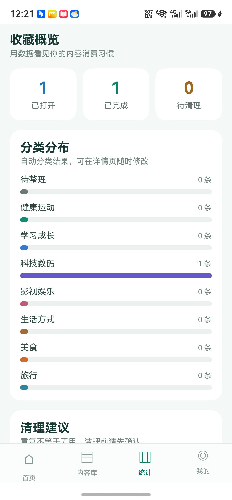
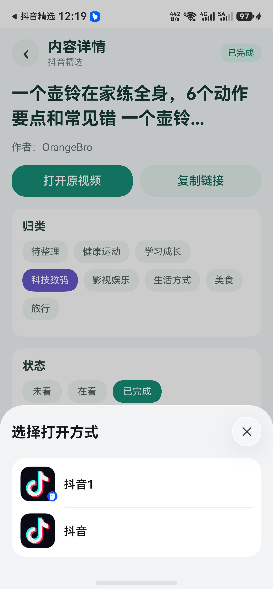

# 收藏夹精灵真机测试结果

> 测试日期：2026-11-24  
> 应用版本：0.2.0  
> 测试结论：系统分享路线通过，MVP 核心闭环可用

## 1. 测试环境

| 项目 | 值 |
|---|---|
| 手机型号 | PLA-AL10 |
| 系统版本 | HarmonyOS 7.0.0.111 |
| API 版本 | 26 |
| 抖音精选版本 | 41.3.0 |
| 应用包名 | com.yongjie.collectiongenie |
| 应用版本 | 0.2.0 |
| 签名方式 | 华为 AGC 调试证书 + 当前设备调试 Profile |

## 2. 结果汇总

| 测试项 | 结果 | 说明 |
|---|---|---|
| 应用编译 | 通过 | ArkTS 编译与 HAP 打包成功 |
| 官方调试签名 | 通过 | 使用 AGC 调试证书和 Profile |
| 真机安装 | 通过 | 安装到当前测试手机 |
| 系统分享入口出现 | 通过 | 在系统分享面板中显示“收藏夹精灵” |
| 分享面板入口位置 | 通过 | 需要进入“系统分享”，再向左滑动找到应用 |
| 分享数据接收 | 通过 | 成功取得抖音标题和 `v.douyin.com` 链接 |
| 首次自动收录 | 通过 | 创建一条本地收藏记录 |
| 自动分类 | 通过 | 壶铃健身视频被分类为“健康运动” |
| 重复分享检测 | 通过 | 再次分享仍为 1 条记录，分享次数增加到 2 |
| 搜索与分类筛选 | 通过 | 按分类和关键词过滤可用 |
| 分类修改 | 通过 | 可改为“科技数码”并即时生效 |
| 状态修改 | 通过 | 可标记为“已完成”并即时生效 |
| 统计页 | 通过 | 分类分布和完成数量正确更新 |
| 打开原视频 | 通过 | 拉起系统应用选择器，可选择抖音应用 |
| 应用图标 | 通过 | 系统分享面板显示自定义图标 |
| 剪贴板兜底 | 代码保留 | 核心路线已通过，未作为主流程依赖 |

## 3. 关键证据

### 3.1 分享面板

### 3.2 自动收录

### 3.3 重复分享

### 3.4 内容详情

### 3.5 使用统计

### 3.6 打开原视频

## 4. 发现的问题与处理

### 4.1 图标在分享面板中显示为空

处理：补充 PNG 应用图标，并使用分层图标配置重新打包，最终分享面板已显示图标。

### 4.2 分享标题开头带多余标点

处理：增加标题清洗规则，清理推广文案和首尾标点。历史记录会在数据库初始化时自动修正。

### 4.3 重复分享可能使用不同短链

处理：在规范链接去重之外，增加“平台 + 标题”兜底匹配。同一视频重复分享时累计分享次数。

### 4.4 修改分类或状态后详情页不刷新

处理：更新数据库后强制重新加载选中记录，界面即时刷新。

## 5. 当前边界

- 仍无法自动读取抖音原有收藏夹。
- 仅能管理用户主动分享进来的内容。
- 分享面板需要先选“系统分享”，再横向滑动到后续应用。
- 应用目前只保存链接、标题和本地整理数据，不保存完整视频。
- 当前签名 Profile 绑定测试设备；其他手机需要重新添加设备并生成 Profile。
