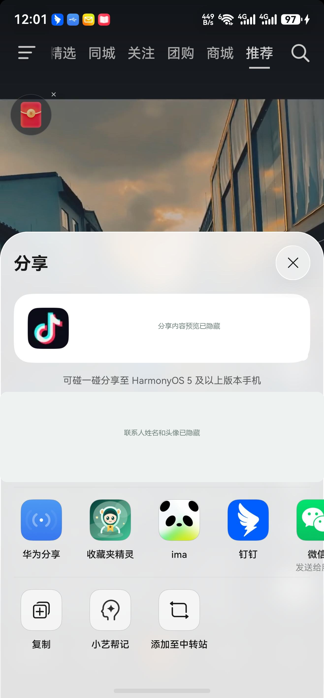
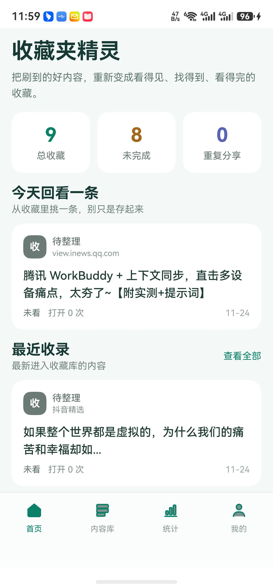
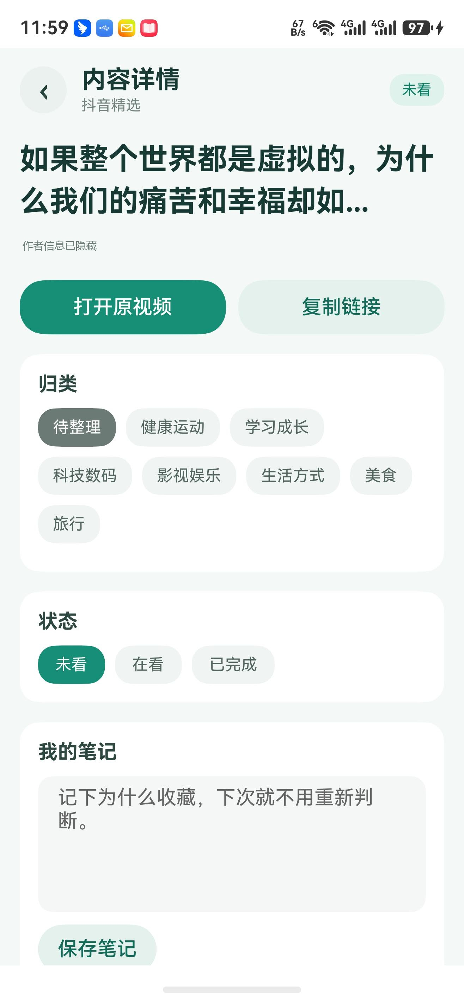
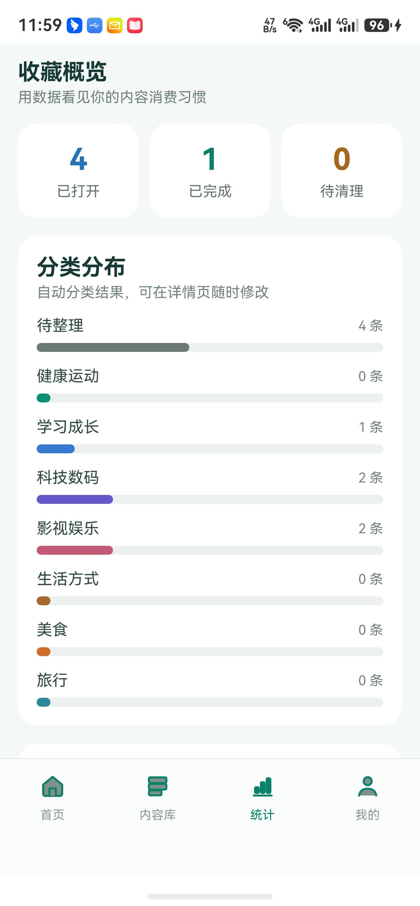
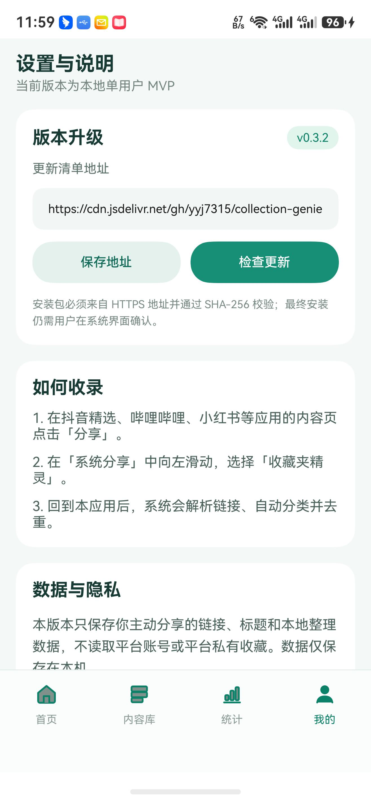
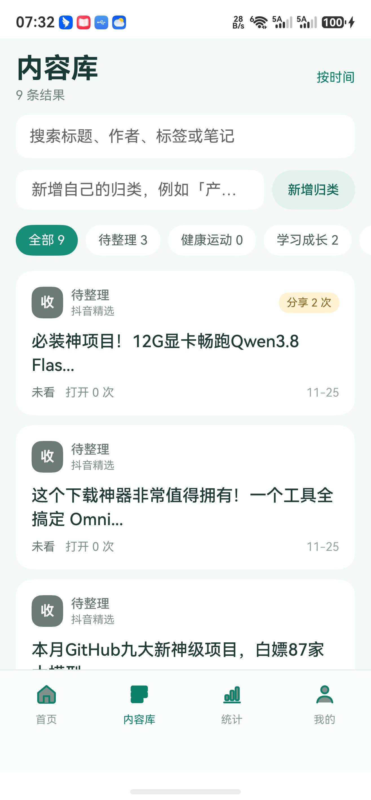
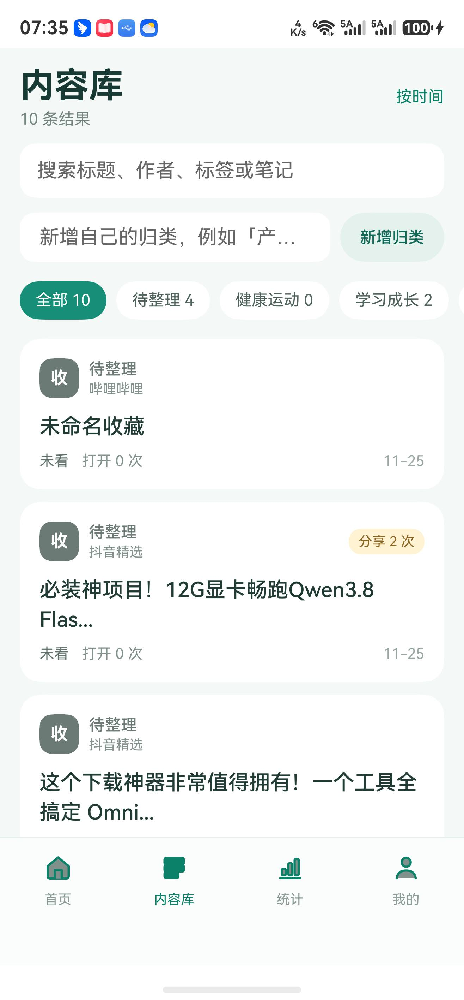
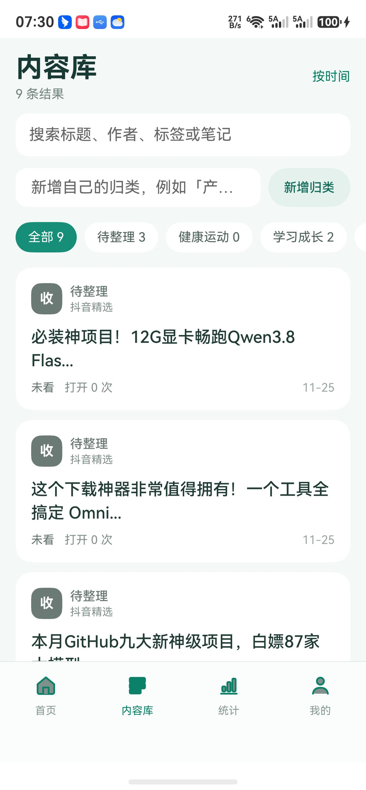
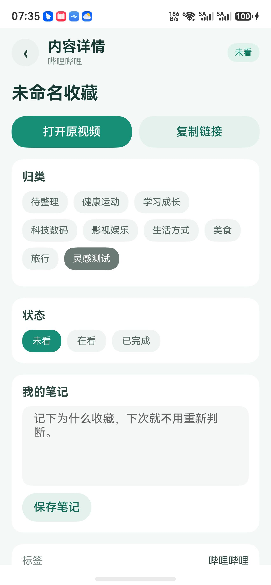
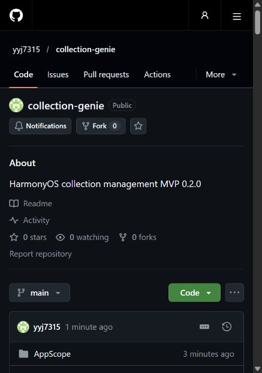

# 收藏夹精灵真机测试结果

> 测试日期：2026-11-25
>
> 应用版本：0.4.0
>
> 测试结论：0.4.0 已通过编译、签名、覆盖安装和新增功能真机验证；原有 9 条收藏保留

## 1. 测试环境

| 项目 | 值 |
|---|---|
| 手机型号 | PLA-AL10 |
| 系统版本 | HarmonyOS 7.0.0.111 |
| API 版本 | 26 |
| 抖音精选版本 | 41.3.0 |
| 应用包名 | com.yongjie.collectiongenie |
| 应用版本 | 0.4.0 |
| 签名方式 | 华为 AGC 调试证书 + 当前设备调试 Profile |

## 2. 结果汇总

| 测试项 | 结果 | 说明 |
|---|---|---|
| 应用编译 | 通过 | ArkTS 编译与 HAP 打包成功 |
| 官方调试签名 | 通过 | 使用 AGC 调试证书和 Profile |
| 真机安装 | 通过 | 安装到当前测试手机 |
| 系统分享入口出现 | 通过 | 在系统分享面板中显示“收藏夹精灵” |
| 分享面板入口位置 | 通过 | 需要进入“系统分享”，再向左滑动找到应用 |
| 分享数据接收 | 通过 | 成功取得抖音标题和 `v.douyin.com` 链接 |
| 首次自动收录 | 通过 | 创建一条本地收藏记录 |
| 自动分类 | 通过 | 壶铃健身视频被分类为“健康运动” |
| 重复分享检测 | 通过 | 再次分享仍为 1 条记录，分享次数增加到 2 |
| 搜索与分类筛选 | 通过 | 按分类和关键词过滤可用 |
| 分类修改 | 通过 | 可改为“科技数码”并即时生效 |
| 状态修改 | 通过 | 可标记为“已完成”并即时生效 |
| 统计页 | 通过 | 分类分布和完成数量正确更新 |
| 打开原视频 | 通过 | 拉起系统应用选择器，可选择抖音应用 |
| 应用图标 | 通过 | 系统分享面板显示自定义图标 |
| 剪贴板兜底 | 代码保留 | 核心路线已通过，未作为主流程依赖 |
| 哔哩哔哩来源识别 | 通过 | 回归载荷验证链接按域名标记为“哔哩哔哩” |
| 历史来源纠正 | 已实现 | 启动时按原始链接修正既有错误来源和平台标签 |
| 底部导航安全区 | 通过 | 四个入口完整显示且可点击 |
| 多平台来源识别 | 通过 | 已知平台按域名精确命名，未知 HTTPS 域名保留实际域名 |
| 底栏图标统一 | 通过 | 四个入口统一为 24×24 线性矢量图标并居中对齐 |
| 动漫精灵应用图标 | 通过 | 新图标已写入桌面、启动页与分享资源 |
| 同签名覆盖升级 | 通过 | 0.3.1 覆盖升级至 0.3.2，9 条收藏数据保留 |
| 数据库版本迁移 | 通过 | 启动后完成 schema 版本升级且历史数据可正常读取 |
| 在线版本检查 | 已实现 | 支持 AppGallery 更新检测及 HTTPS 清单检查 |
| 升级包下载校验 | 已实现 | 下载后执行 SHA-256 校验，失败自动删除文件 |
| 0.4.0 HAP 编译与签名 | 通过 | ArkTS 编译、资源编译、打包和调试签名成功 |
| 0.4.0 真机覆盖安装 | 通过 | 安装到原包名，未卸载或清空应用数据 |
| 版本元数据 | 通过 | 设备包信息显示 `versionName=0.4.0`、`versionCode=1000009` |
| 划词扩展注册 | 通过 | 系统包信息包含 `SelectionExtAbility`，类型为 selection |
| 原有收藏保留 | 通过 | 首次启动完成 schema v1 → v2 迁移后，原有 9 条收藏全部保留 |
| v2 分类表迁移 | 通过 | 数据库版本为 2，生成 8 个默认归类；自定义归类写入同一张表 |
| 剪贴板快捷收录 | 通过 | 复制已有收藏链接后，经系统 `PasteButton` 收录，重复记录合并且分享次数递增 |
| 截图二维码识别 | 通过 | 从相册选择二维码截图，识别出哔哩哔哩链接并创建第 10 条测试收藏 |
| 自定义归类新增 | 通过 | 新增“灵感测试”后即时成为筛选条件，并写入 `categories` 表 |
| 自定义归类使用 | 通过 | 在内容详情中可将测试收藏切换到“灵感测试”，选中状态立即更新 |
| 自定义归类持久化 | 通过 | 强制结束并重启应用后，自定义归类仍存在 |
| 测试数据清理 | 通过 | 二维码测试收藏已从应用内删除，原有 9 条收藏保持不变 |

以下同时保留 0.3.2 的系统分享基线，并加入 0.4.0 真机界面截图。

## 3. 关键证据

### 3.1 分享面板

### 3.2 自动收录

### 3.3 重复分享

### 3.4 内容详情

### 3.5 使用统计

### 3.6 当前版本升级入口

### 3.7 0.4.0 快捷收录

### 3.8 0.4.0 自定义归类

## 4. 发现的问题与处理

### 4.1 图标在分享面板中显示为空

处理：补充 PNG 应用图标，并使用分层图标配置重新打包，最终分享面板已显示图标。

### 4.2 分享标题开头带多余标点

处理：增加标题清洗规则，清理推广文案和首尾标点。历史记录会在数据库初始化时自动修正。

### 4.3 重复分享可能使用不同短链

处理：在规范链接去重之外，增加“平台 + 标题”兜底匹配。同一视频重复分享时累计分享次数。

### 4.4 修改分类或状态后详情页不刷新

处理：更新数据库后强制重新加载选中记录，界面即时刷新。

## 5. 当前边界

- 仍无法自动读取抖音原有收藏夹。
- 仅能管理用户主动分享进来的内容。
- 分享面板需要先选“系统分享”，再横向滑动到后续应用。
- 应用目前只保存链接、标题和本地整理数据，不保存完整视频。
- 当前签名 Profile 绑定测试设备；其他手机需要重新添加设备并生成 Profile。

## 6. 0.3.2 当前版本验证

- 四个导航图标统一为 24×24 SVG，实际显示尺寸和纵向位置一致。
- “我的”页面提供更新清单地址、版本检查、下载校验与系统安装入口。
- 默认通过 jsDelivr `latest` 标签读取清单，真机显示“当前已是最新版本 v0.3.2”。
- 新动漫精灵图标已应用于桌面、启动页和系统分享资源。
- 公开截图中的联系人和作者姓名均已做不可恢复遮盖。

## 7. GitHub 公开仓库

- `yyj7315/collection-genie` 已切换为 Public。
- 未登录浏览器可直接访问源码、README、版本标签和升级产物。

## 8. 0.4.0 发布准备

- 安装包：`artifacts/collection-genie-0.4.0.hap`
- SHA-256：`5301DB52A8E83FC04C7C8325C6F18D5ACCDC85088966E7ECCDAEC0B3D3E80955`
- 数据库 schema：1 → 2
- 新增 `categories` 表，默认 8 个归类，自定义归类随收藏数据持久化
- 文本选择扩展仅适用于 HarmonyOS PC/二合一设备；手机端使用分享、剪贴板和截图二维码入口
