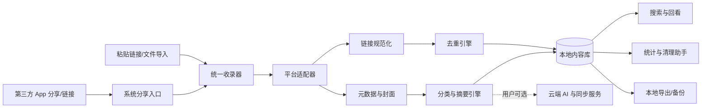

# 收藏夹精灵项目计划书

> 文档版本：V1.0  
> 编写日期：2026-11-23  
> 产品形态：HarmonyOS 手机应用，可选云端服务  
> 当前阶段：立项与可行性验证

## 1. 项目摘要

### 1.1 项目背景

用户在抖音精选、哔哩哔哩、小红书等 App 中看到有价值的内容时，通常会直接使用各平台自带的“收藏”功能。随着时间推移，会出现以下问题：

- 收藏分散在不同 App，无法统一查找。
- 收藏时没有分类，日后只能依赖模糊记忆搜索。
- 相同或高度相似的内容被重复收藏。
- 收藏后长期不浏览，形成“数字仓鼠”式积压。
- 各平台只提供简单收藏列表，缺少个人使用情况、内容价值和清理建议。

### 1.2 产品定义

“收藏夹精灵”是一款面向 HarmonyOS 用户的个人收藏内容管理工具。它把用户主动分享或导入的视频、文章链接统一收录到本地内容库，通过自动提取信息、AI 分类、去重、全文搜索、浏览记录和清理建议，解决“收藏散、找不回、重复多、不会看”的问题。

### 1.3 核心价值

**一条链接进入，一个地方管理；收藏之后能找到、看得完、清得掉。**

### 1.4 立项结论

**有条件立项。**

项目应拆成两个阶段决策：

1. 先进行 2 周可行性验证，重点验证系统分享入口、链接解析覆盖率、主要平台元数据获取能力。
2. 当分享收录成功率达到可接受水平后，再投入完整 MVP 开发。

不建议把“自动读取其他 App 的收藏夹”作为首版前提。HarmonyOS 应用受沙箱和权限机制保护，无法无条件访问抖音、哔哩哔哩等第三方 App 的私有收藏数据；绕过平台授权的读取或自动化操作还存在合规、稳定性和下架风险。

## 2. 项目目标

### 2.1 用户目标

- 在 3 秒左右完成一次收藏归档，尽量不打断原 App 使用。
- 新收藏能自动获得分类、标签和内容摘要。
- 能通过关键词、分类、平台、状态快速找到内容。
- 相似内容能被集中提示，由用户一次性合并或清理。
- 能识别长期未打开、长期未完成和重复收藏的内容。
- 浏览和收藏数据默认只保存在本机，用户对数据拥有控制权。

### 2.2 业务目标

- 验证跨 App 收藏管理是否存在足够强的真实需求。
- 先以低成本 MVP 验证“分享收录”这一关键交互。
- 验证用户是否愿意持续回访、清理和消费收藏内容。
- 为后续云同步、跨设备、知识沉淀和订阅服务建立数据基础。

### 2.3 MVP 成功指标

| 指标 | 目标值 | 统计口径 |
|---|---:|---|
| 分享收录成功率 | ≥ 85% | 用户发起分享后，成功生成卡片的比例 |
| 首版支持平台的核心链接识别率 | ≥ 95% | 已列入支持的平台链接中，可提取至少标题或平台 ID 的比例 |
| 标题、作者、封面综合元数据完整率 | ≥ 75% | 至少 3 项核心字段成功的比例 |
| 自动分类建议接受或轻改率 | ≥ 70% | 用户直接接受或只修改一个分类的比例 |
| 重复检测准确率 | ≥ 90% | 系统标记重复的内容中，确属重复或强相关的比例 |
| 搜索 Top 3 命中率 | ≥ 80% | 测试问题集中，正确答案出现在前 3 条的比例 |
| 内测用户第 7 日留存 | ≥ 25% | 完成首次收藏后 7 日仍有有效行为的用户 |
| 26+ 周后仍保留 | 观察指标 | 不做首版硬性承诺，用于评估长期价值 |

## 3. 用户与使用场景

### 3.1 目标用户

首批用户画像：

- 日常频繁浏览短视频、中长视频和图文内容。
- 至少使用 2 个内容平台，收藏数量通常超过 100 条。
- 有学习、健身、做饭、旅行、数码、职场等明确兴趣。
- 愿意为了更快的后续查找，多执行一次“分享到收藏夹精灵”的操作。

### 3.2 核心场景

1. **即时收录**
   在哔哩哔哩看到教程，点击分享并选择“收藏夹精灵”，应用自动读取链接、标题、作者和封面，推荐分类后保存。

2. **集中整理**
   周日晚上打开“待整理”页，批量确认 AI 建议分类，合并重复内容，给高价值内容补充笔记。

3. **快速找回**
   用户只记得“一个讲手机摄影构图的视频”，通过关键词或语义搜索找到原链接，并查看自己此前写下的摘要。

4. **计划回看**
   应用根据收藏时长、内容长度和用户空闲时间，推荐一份每周可执行的“回看清单”。

5. **清理积压**
   应用列出 90 天未打开、重复或低互动收藏，用户选择保留、归档或前往原平台取消收藏。

6. **查看个人内容画像**
   查看各平台收藏占比、主题分布、打开率、完成率、积压趋势和清理成果。

## 4. 产品原则

- **用户主动授权**：内容通过系统分享、粘贴、文件导入或平台授权进入，不偷偷抓取。
- **本地优先**：默认在本机保存索引、分类和统计；只有用户开启时才同步或使用云端 AI。
- **低打扰**：分享后先完成保存，再在后台补全信息，不要求用户填写复杂表单。
- **可解释**：AI 分类、重复判断和清理建议要展示依据，用户可撤销。
- **不破坏原平台**：应用定位为管理辅助层，不修改第三方 App，不保存第三方账号密码。
- **渐进增强**：元数据拿不到时仍允许以标题、链接和用户备注建立可用条目。

## 5. 核心功能规划

### 5.1 收藏入口

首版提供四类入口，按优先级实现：

1. **系统分享**
   用户在第三方 App 点击分享，选择“收藏夹精灵”，应用接收文本或链接。

2. **粘贴链接**
   用户复制链接后进入应用，应用自动识别剪贴板中的内容并询问是否收藏。剪贴板读取仅在用户主动打开应用或点击粘贴按钮时发生。

3. **文件导入**
   支持标准 CSV、JSON 和浏览器书签 HTML。后续可增加 B 站等平台经用户授权取得的官方导出文件。

4. **快捷服务**
   探索 HarmonyOS 服务卡片、系统分享面板快捷入口或快捷指令，减少操作步骤。

说明：各第三方 App 对“分享”菜单的控制不同，部分内容可能不允许分享到外部应用。首版应通过真实设备矩阵验证，而不是假定所有平台一致。

### 5.2 链接解析与内容卡片

收藏成功后生成统一内容卡片：

- 标题
- 平台
- 作者/UP 主
- 封面
- 时长
- 发布时间
- 原始链接
- 规范链接
- 平台内容 ID
- 用户备注
- 分类与标签
- 收藏时间
- 最近打开时间
- 打开次数
- 状态
- AI 摘要
- 重复组
- 本地缓存大小

解析策略：

- 先用平台适配器识别 URL，提取平台 ID、规范链接和可公开获取的元数据。
- 可从网页公开元数据中获取的信息优先使用网页解析。
- 解析失败时保存原始链接和可读标题，并标记“待补全”。
- 封面只做小尺寸缓存；默认不下载完整视频，避免反向占用本地资源。
- 平台页面结构变化时，通过远程规则更新或适配器版本升级修复。

### 5.3 分类与标签

首次使用提供一套可修改的默认分类：

- 知识技能
- 工作学习
- 科技数码
- 影视娱乐
- 生活方式
- 健康运动
- 美食旅行
- 待整理

分类规则：

- 采用“分类 + 标签”，不使用深层文件夹树作为主要组织方式。
- 一条内容可属于一个主分类和多个标签。
- AI 只给建议，最终结果可一键确认或修改。
- 支持用户自定义分类、合并分类和批量迁移。
- 支持“智能分类”和“手动分类”同时存在，用户可关闭 AI 建议。

分类信号按优先级使用：

1. 用户自定义规则。
2. 标题、简介、作者和平台标签。
3. 用户历史纠正记录。
4. 视频字幕、OCR 或语音转写内容。
5. 云端大模型增强。

### 5.4 去重与相似内容

去重分为四级：

1. **完全相同**：平台与内容 ID 相同。
2. **等价链接**：同一内容的不同分享参数、短链接或跳转链接。
3. **同源重复**：同一作者、相近标题、相似封面或相似时长。
4. **跨平台相似**：不同平台转载或围绕同一主题的近似内容。

处理方式：

- 完全相同和等价链接可自动合并，保留最早收藏记录和全部来源。
- 同源重复和跨平台相似只提示，不自动删除。
- 分组展示“保留主版本、查看其他版本、拆分、不是重复”。
- 用户操作应可撤销。

### 5.5 搜索与发现

- 标题、作者、平台、分类、标签、备注全文搜索。
- 支持拼音首字母和模糊搜索。
- 支持自然语言语义搜索，例如“找那个讲小户型收纳的视频”。
- 支持组合筛选：平台、分类、状态、收藏时间、是否重复、是否长期未看。
- 首页提供“继续看”“今日回顾”“历史上的今天收藏”等轻量回看入口。

### 5.6 浏览与完成状态

由于应用无法读取第三方 App 内的真实播放进度，首版必须区分概念：

- **已打开**：用户通过应用跳转到原平台。
- **已确认完成**：用户手动标记看完或完成。
- **收藏后未打开**：收藏超过设定天数且从未从本应用打开。

页面可记录打开时间、打开次数、跳回后是否标记完成，但不得把“打开链接”等同于“已看完”。

状态建议：

- 待整理
- 待看
- 进行中
- 已完成
- 已归档
- 待清理

### 5.7 数据统计

首版统计页面包含：

- 总收藏数、本周新增、本周完成。
- 平台分布、分类分布、标签 Top 10。
- 平均收藏后首次打开间隔。
- 7/30/90 天未打开数量。
- 重复内容数量与已处理数量。
- 本地缓存占用。
- 每周回看清单完成率。
- 收藏主题随时间的变化趋势。

后续版本可增加：

- 高价值创作者分布。
- “收藏 - 打开 - 完成”漏斗。
- 用户主动评分与内容价值关联。
- 月度数字清理报告。

### 5.8 清理助手

清理不是直接删除第三方收藏，而是：

1. 在本应用中将内容标记为已归档或待清理。
2. 提供原平台深链，方便用户前往取消收藏。
3. 记录用户清理结果，避免重复提醒。
4. 允许清除应用内封面缓存、解析缓存和废弃记录。

只有在目标平台提供合法、稳定的删除接口并取得用户授权后，才考虑“一键取消原平台收藏”。

## 6. 明确不做与首版边界

### 6.1 首版不做

- 不自动登录用户第三方账号。
- 不要求用户输入平台账号密码。
- 不读取其他 App 的私有数据库或缓存。
- 不使用无障碍服务模拟点击批量抓取。
- 不自动下载完整视频。
- 不承诺实时同步平台新增收藏。
- 不承诺准确判断第三方 App 内的观看进度。
- 不直接删除原平台收藏。
- 不做公开内容社区、评论或转载。

### 6.2 后续待评估

- 平台官方授权 API 接入。
- 浏览器扩展或桌面端辅助导入。
- 多设备同步与家庭共享。
- 字幕提取、OCR 和长视频摘要。
- 与笔记、待办、日历联动。
- 端侧模型与云端模型协同。

## 7. 技术方案

### 7.1 总体架构



### 7.2 客户端技术栈

- UI 与业务层：ArkTS、ArkUI。
- 本地数据库：HarmonyOS 关系型数据库，负责内容、分类、标签、事件和重复组。
- 轻量配置：首选项存储。
- 文件缓存：应用沙箱文件目录，按容量上限自动回收。
- 全文检索：优先使用系统能力；若不满足语义需求，再增加本地倒排索引。
- 安全存储：平台账号令牌、云同步凭证使用系统安全存储，不写入普通配置。
- 后台任务：使用系统允许的任务机制补全元数据，避免常驻后台。

### 7.3 核心模块接口

```text
ShareReceiver        接收系统分享载荷
ImportParser         解析粘贴文本、CSV、JSON、书签文件
UrlNormalizer        清洗跳转参数并生成规范链接
PlatformAdapter      按平台提取 ID 与元数据
MetadataEnricher     补全标题、作者、封面、摘要
ClassificationEngine 规则 + 模型分类
DedupEngine          精确与相似去重
SearchService        关键词、筛选、语义搜索
EventTracker         记录打开、完成、整理和清理事件
InsightService       聚合统计和推荐回看
ExportService        导出 JSON/CSV 及备份
```

每个平台适配器应独立版本化。平台页面改版时只替换对应适配器，不牵动主流程。

### 7.4 AI 使用策略

第一阶段先采用“规则 + 用户历史 + 轻量模型”：

- 基于域名、标题关键词、作者、平台标签做高置信度分类。
- 用规范化文本生成向量，实现语义搜索和相似内容提示。
- 用户纠正分类后更新个人偏好。

第二阶段再引入云端大模型：

- 生成摘要、主题标签和回看建议。
- 用户明确同意后才上传必要文本。
- 支持关闭云端 AI、清除已上传数据和选择仅本地模式。

不建议首版直接处理完整视频。视频转写和视觉理解成本高，也容易带来版权与隐私问题。优先使用标题、简介、公开字幕和用户备注。

### 7.5 数据模型草案

**ContentItem**

| 字段 | 说明 |
|---|---|
| id | 本地唯一标识 |
| platform | 平台标识 |
| platformItemId | 平台内容 ID，可为空 |
| originalUrl | 原始链接 |
| canonicalUrl | 规范化链接 |
| title | 标题 |
| creator | 作者 |
| coverRef | 本地缩略图引用 |
| durationSec | 时长 |
| publishedAt | 发布时间 |
| importedAt | 收录时间 |
| notes | 用户备注 |
| summary | AI 或用户摘要 |
| primaryCategoryId | 主分类 |
| status | 内容状态 |
| openCount | 打开次数 |
| lastOpenedAt | 最近打开时间 |
| completedAt | 完成时间 |
| duplicateGroupId | 重复组 |
| contentFingerprint | 用于相似判断的指纹 |

**Event**

记录 `imported`、`opened`、`classified`、`deduplicated`、`completed`、`archived`、`deleted` 等事件。统计数据从事件聚合生成，避免各页面重复维护计数。

### 7.6 系统分享可行性验证

这是项目第一优先级技术门槛，必须用真实设备、目标 HarmonyOS 版本和至少 4 个目标 App 验证：

- 应用能否注册为系统分享目标。
- 是否可以接收纯文本、链接和文本/图片混合载荷。
- 分享动作是否必须额外点击，是否容易误触。
- 第三方 App 分享出的链接是否包含足够的内容 ID。
- 链接在无登录状态能否取得公开标题、作者和封面。
- 失败时能否优雅退化为“粘贴链接 + 手动标题”。

该验证不通过时，应及时调整产品，改为“剪贴板收录 + 书签/文件导入”为主，不应继续假设自动同步可行。

## 8. 信息架构与页面

建议首版使用四个主导航：

1. **首页**
   - 快速收录
   - 待整理
   - 继续看
   - 今日回顾
   - 最近收藏

2. **内容库**
   - 分类
   - 标签
   - 平台筛选
   - 搜索
   - 排序
   - 批量整理

3. **发现**
   - 智能回看清单
   - 相似内容
   - 长期未看
   - 主题合集

4. **我的**
   - 数据统计
   - 清理助手
   - 导入导出
   - 隐私与 AI 设置
   - 缓存管理

关键交互要求：

- 分享后不强制进入应用，先给出系统级“已收录”反馈。
- 分类建议可一次确认多个，避免逐条操作。
- 所有 AI 和批量操作应支持撤销。
- 大列表采用分页和图片懒加载。
- 10,000 条内容时，列表滚动和搜索仍需可用。

## 9. 隐私、安全与合规

### 9.1 数据处理原则

- 默认本机处理，云端功能明确标注并征得同意。
- 只收集实现功能所必需的数据。
- 不采集第三方账号密码。
- 不将用户收藏列表用于广告画像。
- 不上传原始视频，除非用户主动选择且功能确有必要。
- 支持导出和彻底删除本机数据。

### 9.2 权限策略

- 剪贴板仅在用户主动操作时读取。
- 相册、文件、通知等权限按实际功能请求，不在首次启动时集中索取。
- 不申请无障碍权限完成批量自动化。
- 云同步令牌使用安全存储。

### 9.3 平台与版权

- 只保存链接、公开元数据、用户笔记和必要的缩略图。
- 遵守各平台服务条款和 robots/API 使用规则。
- 不绕过登录、付费墙、访问控制或反爬机制。
- 平台解析失败时展示原始链接，不伪造内容。
- 正式上架前完成应用市场隐私清单、权限说明和第三方 SDK 清单。

### 9.4 主要合规参考

- 《中华人民共和国个人信息保护法》
- 《中华人民共和国数据安全法》
- 《中华人民共和国网络安全法》
- HarmonyOS 应用市场隐私与权限审核要求
- 各内容平台开放接口及用户协议

## 10. 里程碑与排期

### 10.1 推荐节奏

按 10 周 MVP 估算，适用于 1 名全栈开发 + 兼职产品设计/测试，或 2 名开发的小团队。若由 1 人业余开发，建议按 14-16 周估算。

| 阶段 | 周期 | 主要交付 | 退出条件 |
|---|---:|---|---|
| M0 可行性验证 | 第 1-2 周 | 分享入口样机、4 个 App 链接样本、解析率报告 | 收录链路可用，关键风险有结论 |
| M1 基础框架 | 第 3-4 周 | 数据模型、内容库、搜索、设置、导入导出 | 可稳定保存和检索 1,000 条测试数据 |
| M2 收录闭环 | 第 5-6 周 | 分享收录、链接解析、待整理、基础分类 | 核心平台综合元数据完整率达到目标 70% 以上 |
| M3 智能整理 | 第 7 周 | 分类建议、重复组、批量确认、撤销 | 去重准确率达到 90%，操作可回退 |
| M4 回看与统计 | 第 8 周 | 状态、事件记录、回看清单、统计页、清理助手 | 统计定义一致，无重复计数 |
| M5 测试修复 | 第 9 周 | 真机矩阵测试、性能优化、隐私说明、崩溃修复 | P0/P1 缺陷清零 |
| M6 内测发布 | 第 10 周 | 内测包、反馈入口、数据埋点、使用说明 | 20-50 名种子用户完成一周试用 |

### 10.2 关键评审门

**Gate 1：产品是否成立**

- 至少 4 个目标平台中，3 个能通过分享路径稳定收录。
- 可解析平台的核心元数据完整率达到 65%。
- 用户完成首次收录后愿意再次使用。

**Gate 2：智能功能是否值得上线**

- 自动分类明显优于随机，且用户不必逐条纠错。
- 重复提示不会造成大量误报。
- 搜索比直接翻平台收藏列表明显更快。

**Gate 3：是否进入云服务和规模化**

- 用户存在明确的多设备或备份需求。
- 云 AI 成本与订阅价格能够平衡。
- 用户对数据上传有清晰、可控的授权方式。

## 11. 团队与职责

最小团队建议：

| 角色 | 主要职责 | 投入建议 |
|---|---|---|
| 产品/设计 | 需求、交互、分类体系、验收指标 | 0.5-1 人 |
| HarmonyOS 客户端 | UI、本地数据、分享接入、系统能力 | 1 人 |
| 后端/数据 | 元数据补全、API、同步、AI 管线 | 0.5-1 人 |
| 测试/运营 | 真机测试、种子用户、反馈收集 | 0.5 人 |

单人 MVP 也可实施，但应暂缓账号体系、多端同步和复杂云端 AI，把资源集中在收录、查找、去重和清理闭环。

## 12. 成本与商业化假设

### 12.1 首版成本控制

- 不购买视频存储和大规模对象存储，只缓存小尺寸封面。
- AI 先用规则和本地能力，云端模型设置每日额度。
- 先做本地单用户版，避免过早建设账号、支付和运营后台。
- 用应用市场内测与种子用户群验证，不先做大规模投放。

### 12.2 可能的收费结构

免费版：

- 本地收录与分类。
- 基础搜索和统计。
- 有限数量的云端 AI 次数。

订阅版：

- 多设备同步与版本备份。
- 更高 AI 摘要、语义搜索额度。
- 高级内容报告和自动整理规则。

价格应在内测后根据云服务成本与实际使用量确定，不建议在需求验证前锁死。

## 13. 主要风险与应对

| 风险 | 概率 | 影响 | 应对 |
|---|---|---|---|
| 第三方 App 不提供可用的系统分享入口 | 中 | 高 | 用 4 个目标 App 做 Gate 1 验证；提供剪贴板、文件导入兜底 |
| 平台链接解析不稳定 | 高 | 高 | 适配器隔离、版本化、远端规则、解析失败降级 |
| 用户嫌多一步分享而放弃使用 | 中 | 高 | 分享后即时反馈；探索服务卡片；以真实留存验证价值 |
| 自动分类误判导致额外整理负担 | 中 | 中 | 只对高置信度内容自动归类，其余进入待整理；强化一键确认和撤销 |
| 语义去重误报 | 中 | 中 | 首版只提示分组，不自动删除；建立反馈样本持续校准 |
| 云端 AI 带来隐私和成本压力 | 中 | 中 | 默认本地；明确开关；限流和缓存；提供无云版本 |
| 第三方平台条款或接口变化 | 高 | 中 | 不使用私有接口和账号自动化；持续监控解析健康度 |
| 收藏数量增长后性能下降 | 中 | 中 | 分页、索引、缩略图懒加载；以 10,000 条基准测试 |
| 原平台收藏无法直接删除 | 高 | 中 | 产品明确为清理助手，不承诺一键删源；记录人工处理结果 |

## 14. 测试与验收

### 14.1 功能验收

- 分享、粘贴、文件导入三种入口均可创建内容。
- 同一链接重复导入时可被识别。
- 可以编辑分类、标签、备注和状态。
- 可以按关键词、平台、分类、时间筛选。
- AI 建议失败时手动整理仍完整可用。
- 统计数字与事件记录一致。
- 导出文件可再次导入并恢复核心字段。
- 所有删除和批量修改均可撤销或二次确认。

### 14.2 兼容性测试

- 至少覆盖 3 款不同芯片和屏幕尺寸的 HarmonyOS 设备。
- 覆盖目标系统版本范围。
- 覆盖抖音精选、哔哩哔哩、小红书、浏览器等首批平台。
- 覆盖无网络、弱网、链接失效、页面改版和分享内容不完整的情况。

### 14.3 性能验收

- 冷启动到首页可操作：目标 ≤ 2 秒。
- 10,000 条记录时列表首屏：目标 ≤ 1 秒。
- 关键词搜索：目标 ≤ 500 毫秒。
- 单条分享保存完成：目标 ≤ 3 秒，元数据可后台补全。
- 封面缓存达到上限后能自动回收，不无限增长。

## 15. 内测与发布计划

1. 招募 20-50 名重度收藏用户，覆盖不同平台和内容偏好。
2. 让用户真实导入现有收藏，观察首次整理成本。
3. 连续跟踪 2-4 周，记录收录、回看、完成、清理四类行为。
4. 重点访谈“没有继续使用”的用户，判断问题来自入口摩擦、分类质量还是内容价值不足。
5. 达到 MVP 指标且 P0/P1 缺陷清零后，提交应用市场审核。
6. 发布前准备隐私政策、权限说明、用户协议、反馈渠道和数据删除入口。

## 16. 立即执行的下一步

### 第 1 周

- 确认首批平台优先级，建议从抖音精选、哔哩哔哩、小红书、浏览器文章开始。
- 收集每类平台 30 条真实分享样本，覆盖短链、长链、失效链接和无分享入口的情况。
- 在目标 HarmonyOS 真机上制作分享入口最小原型。
- 明确“管理收藏夹”是管理链接索引，不承诺自动接管第三方 App 私有收藏。

### 第 2 周

- 完成链接解析、元数据完整率、分享成功率的技术报告。
- 用可点击原型验证分享收录、分类确认、搜索和清理四条主流程。
- 访谈 5-10 名目标用户，重点验证多一步分享是否可接受。
- 召开 Gate 1 评审，决定进入 MVP，还是切换为以导入和浏览器书签为主的产品方向。

## 17. 立项建议

建议以“**统一收纳 + 智能分类 + 去重 + 回看与清理**”作为产品主线，以“**分享收录**”作为最小可行入口。

首版应坚持本地优先和辅助管理定位，不依赖对第三方 App 的深度侵入。真正决定产品成败的不是模型有多复杂，而是：

1. 用户能否足够低摩擦地把内容收进来。
2. AI 分类是否减少而不是增加整理负担。
3. 用户能否真正找回并消费收藏内容。

只要这三件事成立，再扩展云同步、跨设备、字幕摘要和内容知识库才有业务价值。
